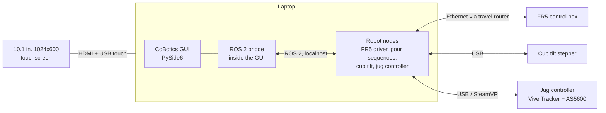
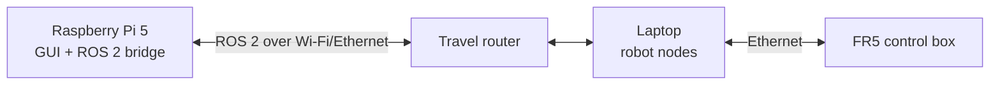

# Integrating the CoBotics GUI with the real system

This guide explains how the v6 touchscreen GUI connects to the Fairino FR5
cobot, the cup tilt mechanism and the teleop jug controller through ROS 2.

Today the GUI runs fully in **simulation**. Every place that needs to talk to
real hardware is a clearly marked seam, listed in
[Integration points](#integration-points). The robot control code itself
(motion programs, the teleop controller) is **out of this project's scope**
per the signed specification. This document defines what the GUI expects from
it, so both sides can be built and tested separately.

> **Status of this document:** the ROS 2 names and message shapes below are
> a **proposal**. Agree them with whoever owns the robot software (Zain /
> Type II Robotics) before writing code against them.

---

## 1. What the GUI does and does not do

| The GUI does | The GUI does not |
|---|---|
| Lets the customer choose: cobot pour, Latte Challenge (teleop) or barista pour | Plan or execute robot motion |
| Asks the robot side to start, cancel or stop a pour | Close any safety loop (it is not a safety-rated device) |
| Shows pour progress, robot state, connection and E-stop state | Calibrate the robot or the jug tracker |
| Scores the teleop pour from the jug's position and tilt | Drive the cobot during teleop (the robot side mirrors the jug) |
| Logs each pour to `logs/service_log.csv` as preference evidence | Store any personal customer data |

---

## 2. Deployment options

Three layouts are supported by the same GUI code. Only the ROS 2 network
settings change between them.

### Option A: laptop runs everything (**used on the run day, 27 Oct 2026**)



- The simplest option, with the fewest network failure points.
- The 10.1" screen is a second display on the laptop. `find_touchscreen()` in
  `main.py` finds the 1024x600 screen and opens the GUI full-screen on it.
  Without it, the GUI opens as a normal window on the laptop screen.
- Set `ROS_LOCALHOST_ONLY=1` (Humble) or `ROS_AUTOMATIC_DISCOVERY_RANGE=LOCALHOST`
  (Jazzy) so ROS 2 traffic stays on the laptop and other devices on the cafe
  network cannot interfere.

### Option B: Raspberry Pi 5 runs everything (future)

The Pi 5 behind the screen runs the GUI **and** the robot nodes and talks to
the FR5 through the travel router. It works like Option A, minus the laptop.

- Pi 5 needs **Ubuntu 24.04 + ROS 2 Jazzy**. Ubuntu 22.04 / Humble does not
  officially support the Pi 5.
- Check that the Fairino ROS 2 driver builds for ARM64 before choosing this.
- Watch CPU load. The GUI animations can be switched off with
  `ANIMATIONS_ENABLED = False` in `pages/animations.py`.

### Option C: Pi runs the GUI, laptop runs the robot (future)



- Keeps the heavy robot software off the Pi, and the screen can sit apart
  from the laptop.
- Both machines must use the **same ROS 2 distribution** and the same
  `ROS_DOMAIN_ID` (pick a non-zero one, e.g. `ROS_DOMAIN_ID=17`, to avoid
  clashing with other ROS users on campus).
- Use a wired link or the private travel router, not the cafe Wi-Fi. DDS
  discovery is unreliable on busy or client-isolated Wi-Fi.
- A lost network link must look like a lost robot. See
  [Connection loss](#connection-loss).

### Choosing between them

| | A: Laptop only | B: Pi only | C: Pi + laptop |
|---|---|---|---|
| Ready for the run day | ✅ | ❌ needs Jazzy on Pi | ❌ needs network testing |
| Hardware to carry | Laptop + screen | Pi + screen | Pi + screen + laptop |
| Network failure points | None (localhost) | Router to FR5 | Router to FR5 and Pi to laptop |
| ROS 2 setup | One machine | One machine, ARM64 | Two machines, shared domain |

---

## 3. Software setup on the GUI machine

Shown for Option A on Ubuntu 22.04 with ROS 2 Humble. For Jazzy, swap the
distribution name.

1. Install ROS 2 Humble and source it: `source /opt/ros/humble/setup.bash`.
2. `rclpy` belongs to ROS's system Python (3.10 on Humble), so the GUI's
   virtual environment must use that interpreter and see system packages:

   ```bash
   python3 -m venv --system-site-packages .venv
   source .venv/bin/activate
   pip install -r requirements.txt
   ```

3. Build the workspace that holds the robot packages and the shared
   interface package (`cobotics_interfaces`, see below), then
   `source install/setup.bash` before launching the GUI.
4. Run the GUI: `python v6/main.py`.

The current Windows development venv (Python 3.10) runs the GUI in
simulation only. ROS 2 integration should be developed on Ubuntu, the same
OS as the run-day laptop.

---

## 4. Proposed ROS 2 interface

One small interface package, `cobotics_interfaces`, shared by the GUI and the
robot nodes:

| Name | Kind | Type | Direction | Purpose |
|---|---|---|---|---|
| `/cobot/pour_latte` | Action | `cobotics_interfaces/action/PourLatte` | GUI → robot | Pour a pattern; feedback gives progress |
| `/cobot/stop` | Service | `std_srvs/srv/Trigger` | GUI → robot | Software stop: halt motion now |
| `/cobot/reset` | Service | `std_srvs/srv/Trigger` | GUI → robot | Re-enable after the area is checked |
| `/cobot/state` | Topic | `cobotics_interfaces/msg/CobotState` | robot → GUI | Ready / busy / fault / E-stop, at 5–10 Hz |
| `/teleop/jug` | Topic | `cobotics_interfaces/msg/JugState` | robot → GUI | Jug position over the cup and tilt, at 30 Hz or more |
| `/teleop/enable` | Service | `std_srvs/srv/SetBool` | GUI → robot | Start/stop mirroring the jug onto the cobot |

```text
# PourLatte.action
string art                 # "Heart" | "Tulip" | "Rosetta"
---
bool success
string message             # shown to staff if success is false
---
float32 progress           # 0.0 – 1.0
string stage               # e.g. "approach", "pour", "pull_through"

# CobotState.msg
uint8 READY=0
uint8 BUSY=1
uint8 FAULT=2
uint8 ESTOP=3
uint8 state
bool physical_estop_pressed
string detail

# JugState.msg  (same meaning as teleop/jug.py JugState)
builtin_interfaces/Time stamp
float32 x                  # -1..1 across the cup, 0 = centre
float32 y                  # -1..1, +y towards the customer
float32 tilt               # 0 = upright, 1 = full pour
```

The jug is published already converted to **cup coordinates**, so the GUI
does not need tracker calibration. The node that reads the Vive Tracker and
AS5600 owns that conversion:

- **Position:** measure the cup centre and rim radius in the tracker frame
  once per setup. Then `x = (px - cx) / r` and `y = (py - cy) / r`.
- **Tilt:** map the AS5600 angle linearly from "upright" (tilt 0) to the
  agreed full-pour angle (tilt 1), and clamp to 0..1.

---

## 5. Integration points in the code

### 5.1 Add a ROS 2 bridge (new file, `robot_bridge.py`)

Qt widgets may only be touched from the GUI thread, and `rclpy` needs its own
spinning thread. The bridge keeps them apart. ROS callbacks emit Qt
**signals**, and Qt queues them onto the GUI thread automatically:

```python
class RobotBridge(QObject):
    # robot -> GUI (emitted from the ROS thread, delivered on the GUI thread)
    pour_progress = Signal(float, str)        # progress 0-1, stage
    pour_finished = Signal(bool, str)         # success, message
    state_changed = Signal(int, bool, str)    # CobotState fields
    connection_changed = Signal(bool)         # robot side alive?
    jug_changed = Signal(float, float, float) # x, y, tilt

    # GUI -> robot (called on the GUI thread, never block it)
    def start_pour(self, art: str) -> None: ...
    def cancel_pour(self) -> None: ...
    def stop(self) -> None: ...               # /cobot/stop, fire-and-forget
    def reset(self) -> None: ...
    def set_teleop(self, enabled: bool) -> None: ...
```

Run `rclpy` with a `MultiThreadedExecutor` in a `threading.Thread` started
by the bridge, and shut it down in `MainWindow.closeEvent`. Keep the bridge
optional: if `rclpy` cannot be imported or the robot never answers, the GUI
should keep starting in SIMULATION mode, as it does now.

### 5.2 Cobot pour (`main.py`)

| GUI code today | With the bridge |
|---|---|
| `start_selected_art()` starts a 5 s timer or waits for staff | Call `bridge.start_pour(art)`. Show the running page only after the goal is **accepted** |
| `_update_operation_progress()` from the timer | Connect `bridge.pour_progress` to `running_page.set_progress()` |
| `complete_operation()` from the timer or the **POUR FINISHED** button | Connect `bridge.pour_finished(True, …)`. On `False`, show the message and return to Home |
| `cancel_operation()` | Also call `bridge.cancel_pour()` |
| `config.MANUAL_POUR_CONFIRM` | Set to `False` once the action reports completion reliably. Keep it `True` as the fallback while the robot side is unfinished |

`running_page.set_manual(False)` switches the running page from the busy bar
to the real percentage.

### 5.3 Emergency stop (`main.py`)

The **physical E-stop remains the safety device.** The on-screen button is an
extra way to request a stop. It is not a safety function.

- `activate_estop()` has the TODO `Send the real robot/controller stop
  request here`. Call `bridge.stop()` there and `bridge.set_teleop(False)`.
- `reset_estop()` has the TODO `Verify physical E-stop and controller safety
  state`. Only clear the GUI's E-stop when the latest `CobotState` reports
  `physical_estop_pressed == False` and the state is not `FAULT`. Then call
  `bridge.reset()`.
- If `CobotState` reports `ESTOP` (someone pressed the physical button), call
  `activate_estop()` so the GUI shows the E-stop page too.

### 5.4 Status bar and status page

- `connection_chip` reads `SIMULATION` today. Show `CONNECTED` /
  `DISCONNECTED` from `bridge.connection_changed`, and call
  `status_page.set_connection_status()`.
- Map `CobotState.state` to `_set_cobot_ready()` / `_set_cobot_running()`
  and to `status_page.set_cobot_status()`.

### 5.5 Teleop jug controller (`teleop/jug.py`)

The game only needs an object with this shape (the `JugController` protocol):

```python
class RosJugController:
    is_assisted = False          # the real jug reports its own tilt

    def read(self) -> JugState:  # latest /teleop/jug sample
        ...
    def reset(self) -> None:     # forget the last sample
        ...
```

- Store the latest sample from `bridge.jug_changed` and return it from
  `read()`. The game polls it every 33 ms.
- Swap it in at `main.py`: `self.jug_controller = SimulatedJugController()`.
- Call `bridge.set_teleop(True)` in `start_teleop_challenge()` once the
  countdown ends. Call `set_teleop(False)` in `TeleopGamePage.abort()`, at
  the end of the pour and on E-stop.
- If no jug sample arrives for more than about 0.3 s, treat the jug as
  upright (tilt 0) so the game cannot pour from stale data.

### 5.6 Connection loss

- The bridge should mark the robot as disconnected when `/cobot/state` has
  not arrived for about 1 s.
- While disconnected, START POUR and LATTE CHALLENGE should be disabled with
  a short note. Barista pour stays available.
- A disconnect during a pour or teleop should end it like a cancel and show
  a staff-facing message. The robot side must also stop on its own if the GUI
  disappears; never rely on the GUI being alive.

---

## 6. Bring-up checklist

Work through these in order. Stop at the first failure.

1. GUI in simulation on the run-day laptop and 10.1" screen: all pages fit
   and touch works.
2. Robot nodes running on their own. The cobot pours with
   `ros2 action send_goal /cobot/pour_latte …` from a terminal, without the GUI.
3. `ros2 topic echo /cobot/state` shows the state changing, including when
   the physical E-stop is pressed and released.
4. GUI + bridge with `MANUAL_POUR_CONFIRM = True`. START POUR sends the goal,
   and staff still confirm the finish.
5. Switch `MANUAL_POUR_CONFIRM = False`. Progress and completion now come
   from the action.
6. On-screen E-stop during a pour: the cobot stops, and reset is refused
   while the physical E-stop is pressed.
7. Physical E-stop during a pour: the GUI switches to the E-stop page by
   itself.
8. Unplug the network or kill the robot nodes mid-pour. The cobot stops and
   the GUI shows DISCONNECTED.
9. `ros2 topic echo /teleop/jug` matches the jug. Centre gives about (0, 0),
   the rim gives about ±1, and upright gives tilt 0.
10. A full Latte Challenge with the real jug and the cobot mirroring it.

Record each result as evidence against the Testing Criteria.

---